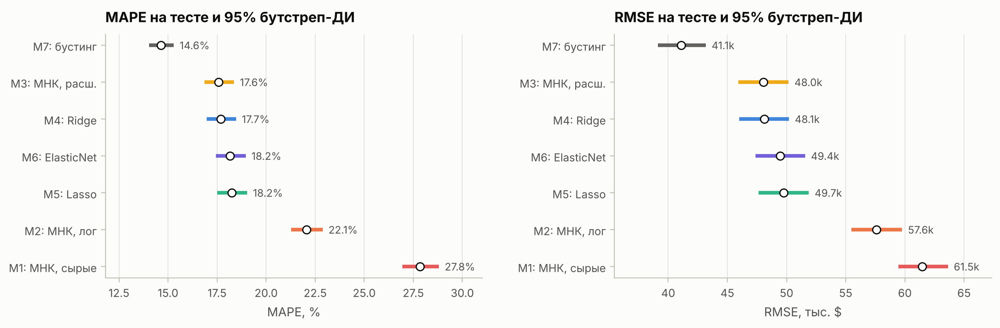

# Оценка залоговой недвижимости линейными моделями

Pet-проект по классическому ML: AVM (automated valuation model) для залогового портфеля на данных California Housing. От МНК с робастным статистическим выводом до регуляризации, предсказательных интервалов и парного сравнения моделей. Один ноутбук: [`avm_linear_models.ipynb`](avm_linear_models.ipynb) — с выполненными ячейками, графики видны прямо на GitHub.



## Результаты (тест, 3 935 объектов)

| Модель | MAPE, % | PE20, % | OVR20, % |
|---|---|---|---|
| M1 МНК, сырые признаки | 27,8 | 49,3 | 31,9 |
| M2 МНК, log-таргет, 16 признаков (интерпретируемая) | 22,1 | 59,0 | 22,9 |
| M4 Ridge, 213 признаков (champion) | 17,7 | 69,8 | 16,9 |
| M7 градиентный бустинг (challenger) | 14,6 | 77,6 | 12,5 |

PE20 — доля оценок с ошибкой ≤ 20%, OVR20 — доля переоценок более чем на 20%.

## Содержание

- **Данные:** цензура таргета, MCAR-проверка пропусков, VIF, винзоризация, гео-признаки (расстояния до агломераций, RBF).
- **МНК с нуля:** QR, HC0/HC1/HC3, кластерные SE, тест Вальда; проверка симуляцией покрытия ДИ (при гетероскедастичности классические SE дают ~80% вместо 95%).
- **Интерпретируемая модель:** Box–Cox, частные остатки, пространственно-кластерные SE (в 1,1–5,5 раза больше HC3), эффекты в процентах, smearing.
- **Регуляризация:** Ridge/Lasso/ElasticNet, правило 1SE, кривые обучения, стабильность коэффициентов.
- **GD/SGD** своими руками: граница шага 2/L, влияние обусловленности.
- **Интервалы:** гомо-/гетероскедастичные, квантильная регрессия, конформные; бэктест нижней границы тестом Купика (проходит только квантильная регрессия).
- **Сравнение моделей:** бутстреп метрик, парные тесты через регрессию, поправки Бонферрони и Холма, кластерные SE.

## Запуск

```bash
git clone https://github.com/klopsh/avm-linear-models.git
cd avm-linear-models
python -m venv .venv && source .venv/bin/activate   # Windows: .venv\Scripts\activate
pip install -r requirements.txt
jupyter lab avm_linear_models.ipynb
```

Данные (Géron, *Hands-On ML*) скачиваются в `data/` при первом запуске, полный прогон занимает около 2 минут. statsmodels не используется: весь МНК-вывод реализован на numpy/scipy.

## Ограничения

Наблюдение — квартал 1990 г., а не отдельный объект; объекты дороже 500 тыс. долл. вне области применимости; случайный сплит не проверяет перенос на новые территории. Подробнее — в разделе 12 ноутбука.
